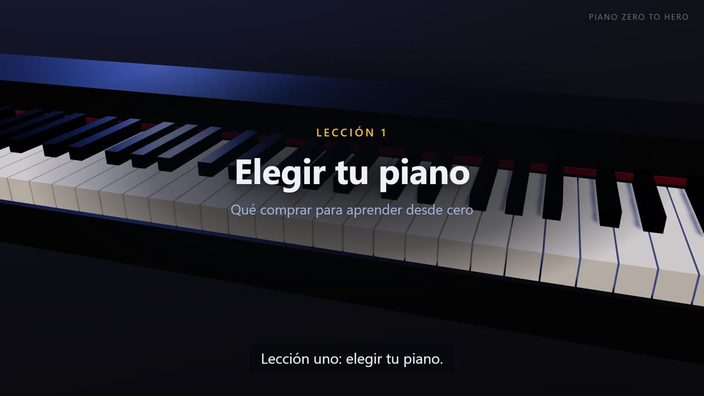
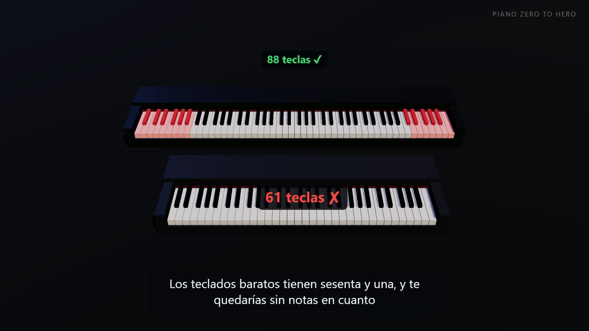
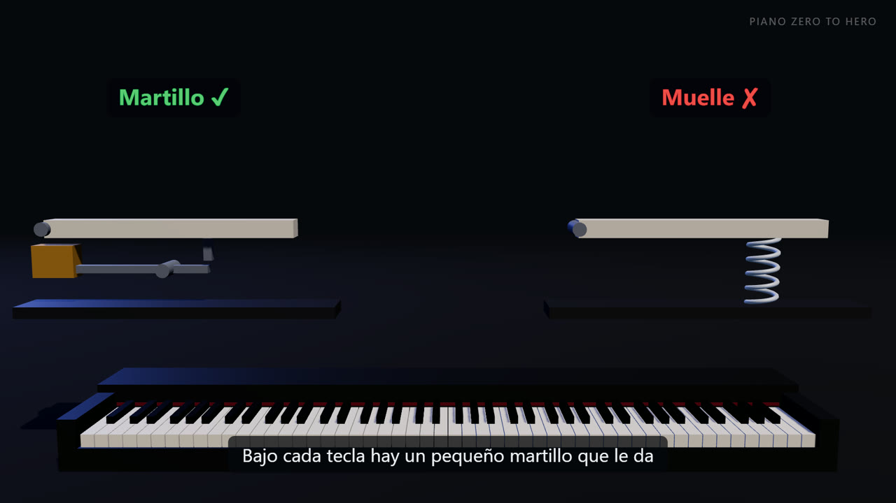
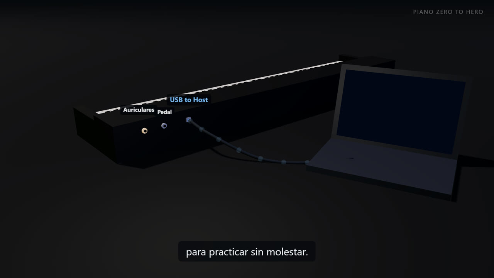

<div align="center">

# 🎹 Piano Zero to Hero

**Un curso de piano para adultos que empiezan de cero, con vídeos 3D generados por código
y laboratorios que te escuchan tocar por USB-MIDI y te ponen nota.**

De no saber dónde está el Do a tocar a dos manos piezas de nivel intermedio y acompañar canciones con acordes.
2 sesiones por semana de 45–60 min, 3–4 años.



[Currículo](curriculum.md) · [Lección 1](lessons/01-elegir-piano/leccion.md) · [Instalación](#-instalación-en-windows) · [Cómo funciona](#-cómo-funciona-la-plataforma)

</div>

---

## ✨ Qué tiene de especial

| | |
|---|---|
| 📚 **Lecciones cortas** | Teoría de una página como mucho, práctica guiada y un tiempo estimado realista. En español. |
| 🎬 **Vídeos 3D** | Un teclado de 88 teclas con medidas reales en Three.js: las teclas se hunden y se iluminan con cada nota, con voz en español y subtítulos. Todo se genera con un comando. |
| 🎹 **Labs con tu piano** | Conectas el piano digital al PC por USB y el lab mide qué notas tocas, con qué precisión rítmica (en ms), con qué fuerza y si usas el pedal. |
| ✅ **Criterios claros** | Cada lección tiene un criterio para darla por superada (p. ej. ≥ 90 % de notas y < 80 ms de desviación). Sin superarlo, no se pasa a la siguiente. |
| 📈 **Progreso** | Cada lab y cada sesión de práctica se apuntan en `progress/log.csv`. Un panel te enseña horas, racha y lecciones superadas. |
| 👩‍🏫 **Profesor de verdad** | Cada 2–3 meses te recomienda una clase con un profesor real: el MIDI no ve tu postura ni la tensión de las manos. |

<table>
<tr>
<td></td>
<td></td>
<td></td>
</tr>
<tr>
<td align="center"><sub>88 teclas frente a 61</sub></td>
<td align="center"><sub>Martillo frente a muelle</sub></td>
<td align="center"><sub>USB-MIDI hasta el PC</sub></td>
</tr>
</table>

---

## 🗺️ El camino

| Nivel | Cuándo | Lo que sabrás hacer |
|---|---|---|
| **0 · Setup** | Semanas 1–3 | Elegir el piano, postura, encontrar cualquier nota en el teclado |
| **1 · Fundamentos** | Meses 1–4 | Cinco dedos, ritmo con metrónomo, leer en clave de sol y de fa, manos juntas |
| **2 · Bases sólidas** | Meses 4–9 | Corcheas, escalas, acordes, pedal, primeras piezas reales |
| **3 · Intermedio inicial** | Meses 9–18 | Tonalidades menores, cifrado americano, acompañamientos, Burgmüller y Bach |
| **4 · Competente** | Años 2–4 | Todas las tonalidades, polifonía, improvisación, Clementi, Chopin, Satie, Einaudi… y *Runaway* |

👉 Las 30 lecciones con sus criterios están en **[curriculum.md](curriculum.md)**.

| # | Lección | Estado |
|---|---|---|
| 1 | [Elegir piano y material](lessons/01-elegir-piano/leccion.md) | ✅ Disponible: lección + vídeo + lab |
| 2 | Montaje, postura y conexión | 🔜 Próximamente |
| 3 | Geografía del teclado | 🔜 |

---

## 🚀 Instalación en Windows

No hace falta saber programar. Copia y pega estos comandos en **PowerShell**.

**1. Descarga el curso** (solo la primera vez):

```powershell
git clone https://github.com/cesucede17/piano-zero-to-hero.git
cd piano-zero-to-hero
```

> ¿No tienes `git`? Instálalo con `winget install Git.Git`, cierra PowerShell, vuelve a abrirlo y repite.

**2. Instala todo** (Python, librerías, el navegador que graba los vídeos y Three.js). Tarda 3–5 min:

```powershell
powershell -ExecutionPolicy Bypass -File .\setup.ps1
```

Al final verás `Listo. Prueba: .\piano.ps1 lab 1` en verde.

**3. Empieza:**

```powershell
.\piano.ps1 lab 1
```

### Comandos del día a día

| Quiero… | Comando |
|---|---|
| Hacer el laboratorio de una lección | `.\piano.ps1 lab 1` |
| Comprobar que el PC ve mi piano | `.\piano.ps1 midi` |
| Ver cómo funciona el detector sin piano | `.\piano.ps1 midi --demo` |
| Apuntar mi práctica de hoy | `.\piano.ps1 practica 25 "escalas de Do"` |
| Ver mi progreso | `.\piano.ps1 progreso` (se abre en el navegador) |
| Volver a generar un vídeo | `.\piano.ps1 video 1` |

### Si algo falla

| Lo que ves | Qué hacer |
|---|---|
| *"la ejecución de scripts está deshabilitada"* | Usa `powershell -ExecutionPolicy Bypass -File .\piano.ps1 lab 1`, o ejecuta una vez `Set-ExecutionPolicy -Scope CurrentUser RemoteSigned` |
| *"Falta la instalación"* | Repite el paso 2 |
| *"No veo ningún piano conectado"* | Enciende el piano **antes**, usa el puerto **USB to Host** (cuadrado), prueba otro USB y cierra otros programas de música. El propio detector te guía. |
| Cualquier otra cosa | Copia el mensaje de error y pégalo en Claude Code |

---

## 🧠 Cómo funciona la plataforma

```
                ┌───────────────── Lección ─────────────────┐
                │  leccion.md   video/guion.json   lab/      │
                └──────┬───────────────┬──────────────┬─────┘
                       │               │              │
           tú lees ◀───┘               ▼              ▼
                            tools/render_video.py   lab/run.py
                            ├─ edge-tts (voz)        ├─ tools/midi_io.py ◀── 🎹 USB-MIDI
                            ├─ síntesis de piano     ├─ tools/quiz.py
                            ├─ Three.js + Playwright ├─ tools/midi_check.py
                            └─ ffmpeg ──▶ .mp4       └─ tools/progress.py ──▶ progress/log.csv
                                                                                    │
                                                          progress/dashboard.py ◀───┘
```

### 🎬 Vídeos generados por código
Cada vídeo sale de dos ficheros de la lección:
- **`video/guion.json`**: el texto de cada escena (narración y subtítulos) y las notas que suenan.
- **`video/escenas.js`**: qué pasa en 3D en cada escena (cámara, teclas, etiquetas, gráficos).

`tools/render_video.py` genera la voz con **edge-tts**, sincroniza subtítulos frase a frase, sintetiza
el audio del piano a partir de las notas, abre la escena **Three.js** en un Chromium sin ventana
(**Playwright**), captura cada frame y lo monta con **ffmpeg** (H.264, 1080p, 30 fps):

```powershell
python tools/render_video.py lessons/01-elegir-piano              # vídeo final
python tools/render_video.py lessons/01-elegir-piano --borrador   # rápido, 540p
python tools/render_video.py lessons/01-elegir-piano --frames 5,60  # solo unas capturas
```

### 🎹 Laboratorios por MIDI
Los labs leen tu piano con `mido` + `python-rtmidi`. Ya funciona el **detector de piano**: comprueba
la conexión, que tenga 88 teclas (La0–Do8), que sea sensible a la velocidad y si el pedal es continuo.
El evaluador de ejercicios (notas, ritmo en ms, dinámica y mano) llega con las lecciones 2–4.

### 🧾 Labs sin piano
Quizzes con explicación de cada respuesta, para la teoría (elección de piano, lectura de notas,
intervalos…).

---

## 📁 Estructura

```
piano-zero-to-hero/
├── README.md            ← estás aquí
├── curriculum.md        ← mapa de las 30 lecciones
├── CLAUDE.md            ← instrucciones del proyecto para Claude Code
├── setup.ps1            ← instalador para Windows
├── piano.ps1            ← atajo para todos los comandos
├── lessons/
│   └── 01-elegir-piano/
│       ├── leccion.md
│       ├── video/       ← guion.json + escenas.js + leccion01.mp4
│       └── lab/         ← run.py + quiz.json
├── tools/               ← motor MIDI, quiz, progreso, render de vídeo
│   └── video/           ← motor 3D (Three.js): teclado, escena, estilos
├── assets/              ← imágenes, partituras, soundfonts
└── progress/            ← tu log.csv + panel (Streamlit)
```

---

## 🛠️ Tecnología

**Python 3.12** (`mido`, `python-rtmidi`, `rich`, `edge-tts`, `playwright`, `numpy`, `streamlit`) ·
**Three.js** · **ffmpeg** (vía `imageio-ffmpeg`, sin instalar nada aparte) · el entorno de Python se
instala en `%USERPROFILE%\.venvs\piano`, **fuera de OneDrive**, para que la sincronización no lo rompa.

### Limitaciones, con honestidad
- El **sonido del piano** de los vídeos es una síntesis sencilla, no un piano sampleado. Está previsto
  pasar a FluidSynth con un soundfont libre (Salamander Grand Piano).
- Las **manos** se representarán con marcadores de dedos 1–5, no con manos realistas. Para postura y
  relajación, las lecciones enlazarán vídeos reales.
- **Repertorio con copyright** (como *Runaway*): el repo no incluye la partitura. Tú compras el
  arreglo y el lab te evalúa con tu archivo MusicXML o MIDI.

---

<div align="center">
<sub>Hecho con 🎹 y <a href="https://claude.com/claude-code">Claude Code</a> · Proyecto personal de aprendizaje</sub>
</div>
